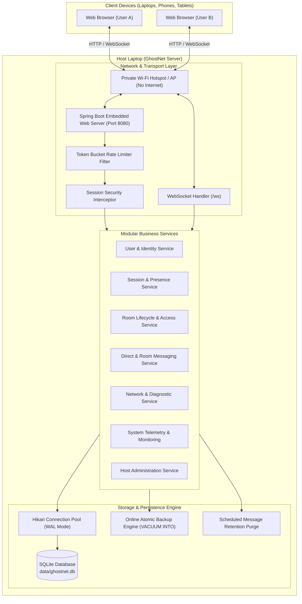
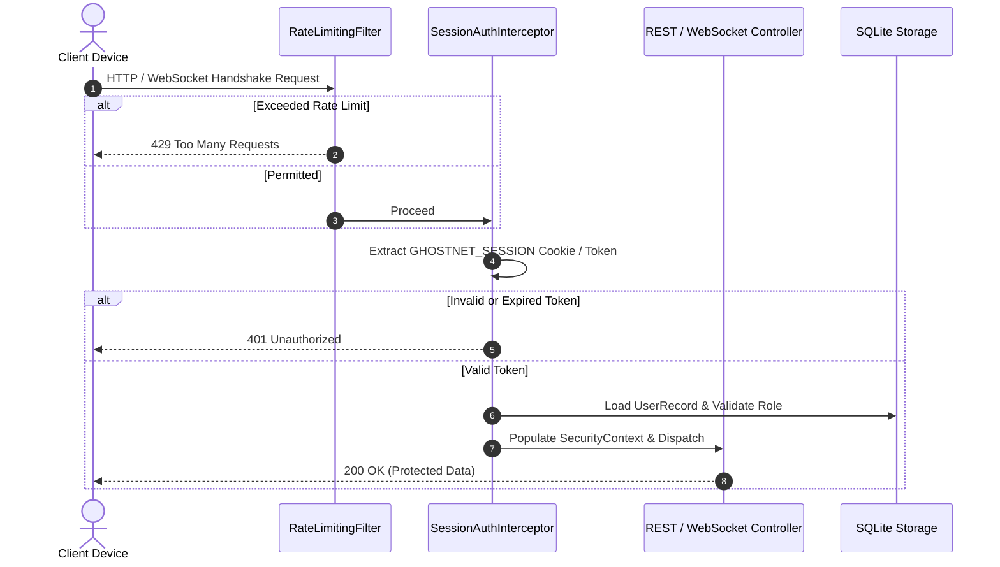

# GhostNet Architecture Specification

**Project Motto:** *YOUR NETWORK. YOUR PEOPLE. YOUR RULES.*  
**Version:** 1.0.0 (Foundational Release)  
**Baseline Platform:** Java 21 LTS with Virtual Threads & Spring Boot 3.3.5

---

## 1. High-Level System Architecture

GhostNet is structured into clean, loosely coupled modules with strict separation of concerns across presentation, business logic, persistence, and real-time network communication.

---

## 2. Module Decomposition

| Module | Package | Primary Responsibility |
| :--- | :--- | :--- |
| **Network Management** | `com.ghostnet.network` | Detects host interfaces, identifies primary reachable IPv4 hotspot address, performs reachability probes distinguishing local vs external network. |
| **User & Identity** | `com.ghostnet.user` | Validates usernames, performs BCrypt password hashing, handles registration, profiles, and initial host admin role assignment. |
| **Session & Presence** | `com.ghostnet.session` | Manages cryptographically secure random session tokens, token expiration, in-memory multi-connection online/offline presence tracking. |
| **Room Management** | `com.ghostnet.room` | Manages room lifecycles, human-readable join codes (`GN-XXXX`), password verification, capacity checks, and owner moderation. |
| **Messaging** | `com.ghostnet.messaging` | Coordinates 1-to-1 direct messaging and room broadcasts, delivery status tracking (`SENT`, `DELIVERED`, `READ`), idempotency deduplication, and zero message logging. |
| **WebSocket Layer** | `com.ghostnet.websocket` | Authenticated handshake interceptor, connection manager with synchronized delivery, JSON protocol frames, typing notifications, and heartbeat monitor. |
| **Persistence** | `com.ghostnet.persistence` | Schema migrations, indexed SQLite tables, automated daily retention purge, online non-blocking database snapshots (`VACUUM INTO`). |
| **Security & Privacy** | `com.ghostnet.security` | Role-based access control (`ROLE_USER`, `ROLE_ADMIN`), token bucket rate limiting, input validation, and password cryptography. |
| **Host Administration** | `com.ghostnet.admin` | Dedicated host dashboard API, session revocation, room moderation, backup triggers, and graceful shutdown hook. |
| **Monitoring** | `com.ghostnet.monitoring` | JVM memory telemetry, CPU metrics, uptime tracking, and message counter telemetry. |

---

## 3. Concurrency & Threading Model

GhostNet is engineered for concurrent, safe, multi-client access in private local networks:

1. **Java 21 Virtual Threads:**
   - Spring Boot is configured with `spring.threads.virtual.enabled=true`.
   - Each HTTP request and background task is served by a lightweight virtual thread, enabling thousands of concurrent client actions without OS thread exhaustion.

2. **SQLite Write-Ahead Logging (WAL):**
   - SQLite is configured with `PRAGMA journal_mode = WAL;`.
   - Readers do not block writers, and writers do not block readers.
   - `PRAGMA busy_timeout = 5000;` ensures that if a momentary lock occurs, threads wait up to 5 seconds rather than failing with `SQLITE_BUSY`.
   - `PRAGMA foreign_keys = ON;` enforces cascade deletion and referential integrity.

3. **Thread-Safe Collections:**
   - Active user sessions, active WebSocket sessions, presence registries, and rate-limiting token buckets all utilize `ConcurrentHashMap` and thread-safe sets (`ConcurrentHashMap.newKeySet()`).
   - Outbound WebSocket frame transmission is synchronized per `WebSocketSession` to prevent interleaved protocol frame corruption.

---

## 4. Persistent Storage & Retention Architecture

### 4.1 Storage Location
All persistent data is stored strictly on the host laptop filesystem:
- **Primary Database:** `data/ghostnet.db` (and associated WAL files `data/ghostnet.db-wal`, `data/ghostnet.db-shm`).
- **Database Snapshots:** `data/backups/ghostnet_backup_YYYYMMDD_HHMMSS.db`.

### 4.2 Data Lifecycle & Server Shutdown
- Shutting down the GhostNet server **makes stored information temporarily inaccessible, not deleted** (Req 200).
- All registered accounts, rooms, memberships, preferences, and message histories survive server restarts.
- Online presence is purely volatile in server memory and resets gracefully on restart.

### 4.3 Retention & Privacy
- Messages older than `ghostnet.retention.message-retention-days` (default 30 days) are automatically purged via scheduled background task (Req 193).
- Message bodies are never written to standard application logs (Req 149, 197).
- Search queries are transient in memory and never persisted to disk (Req 195, 196).

---

## 5. Security & Access Control Architecture

